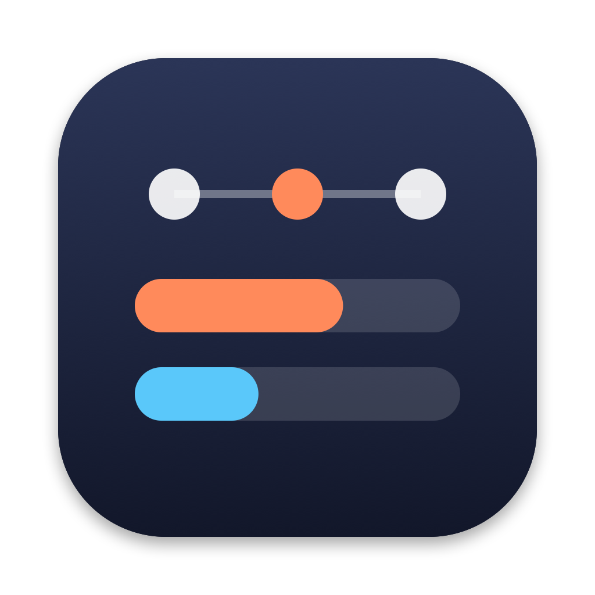

# AgentBar

[Leia em português](README.pt-BR.md)

A macOS menu bar app that shows your Claude Code usage limits and the dynamic workflows running in your sessions.

> Unofficial project, not affiliated with or endorsed by Anthropic. "Claude" and "Claude Code" are trademarks of Anthropic.

## What it shows

- **In the menu bar:** your current session (5-hour) and weekly usage, stacked like the CPU/MEM item. A number turns orange at 70% and red at 90%.
- **When you click it:** both limits with progress bars and reset times, plus the workflows running now or finished in the last 24 hours.
- **For each workflow:** its phases and agents, with model, tokens and elapsed time, like Claude Code's `/workflows` panel.

## Privacy

AgentBar only reads files that Claude Code writes on your Mac, under `~/.claude`. It makes no network requests, has no telemetry and never reads your login token.

## Requirements

- macOS 14 (Sonoma) or later, on Apple Silicon or Intel.
- Claude Code. Usage limits appear when Claude Code reports them to the status line, which depends on your plan. Without them, AgentBar still shows your workflows.

## Install

### Download

1. Download `AgentBar-<version>.zip` from [Releases](https://github.com/WesleyNog/agentBar/releases) and unzip it.
2. Move `AgentBar.app` to your Applications folder.
3. Open it. AgentBar isn't notarized by Apple yet, so macOS blocks the first launch. To allow it, do one of these:
   - Open **System Settings › Privacy & Security**, scroll down and click **Open Anyway** next to the message about AgentBar, then confirm.
   - Or run this in Terminal: `xattr -dr com.apple.quarantine /Applications/AgentBar.app`

   You need to do this again after each update.

### Build from source

Requires Xcode 16 or later.

```bash
git clone https://github.com/WesleyNog/agentBar.git
cd agentBar
./scripts/bundle.sh
open build/AgentBar.app
```

An app you build yourself opens without the security prompt.

## Connect to Claude Code

Click the AgentBar item, then **Connect…**. Before changing anything, AgentBar shows what it will do:

- It installs a small script at `~/.claude/agentbar/statusline.sh` and points `statusLine` in `~/.claude/settings.json` to it. Only that entry changes; the rest of the file stays exactly as it was.
- If you already use a status line, it keeps working: AgentBar's script runs your previous command and prints its output.
- `settings.json` is backed up to `~/.claude/agentbar/backups/` first.

**Disconnect…** in Settings puts back the status line you had before. Settings also has **Open at login**.

The limits update whenever a Claude Code session refreshes its status line, so they only change while you use Claude Code.

## Good to know

- **"tok" is context size, not spending.** As in Claude Code's own panel, the tokens shown for an agent are the size of its context in its latest reply, and a workflow's total is the sum of its agents. Your actual consumption is what the usage percentages show.
- **Workflows are read from Claude Code's internal files.** A Claude Code update can change their format. If something looks wrong, `swift run agentbar-dump` shows what AgentBar is reading. Its output includes your project and workflow names, so review it before sharing it in an issue.
- **Only this Mac.** Usage from claude.ai or other computers shows up the next time a Claude Code session on this Mac refreshes its status line.

## Uninstall

1. Open **Settings…** and click **Disconnect…** to restore your previous status line.
2. Quit AgentBar and move it to the Trash.
3. Optionally, delete `~/.claude/agentbar`.

## Development

```bash
swift build                 # debug build
swift test                  # tests
swift run agentbar-dump     # what AgentBar reads, in the terminal (add --json for JSON)
./scripts/bundle.sh         # build/AgentBar.app
./scripts/release.sh        # build/AgentBar-<version>.zip, universal (Apple Silicon and Intel)
```

- `Sources/AgentBarCore`: reads and parses Claude Code's files. No UI; covered by the tests.
- `Sources/AgentBar`: the menu bar app.
- `Sources/agentbar-dump`: the diagnostic tool.

The spec and plan, in Portuguese, are in [SPEC.md](SPEC.md) and [PLAN.md](PLAN.md).

## License

[MIT](LICENSE) © 2026 Wesley Nogueira
