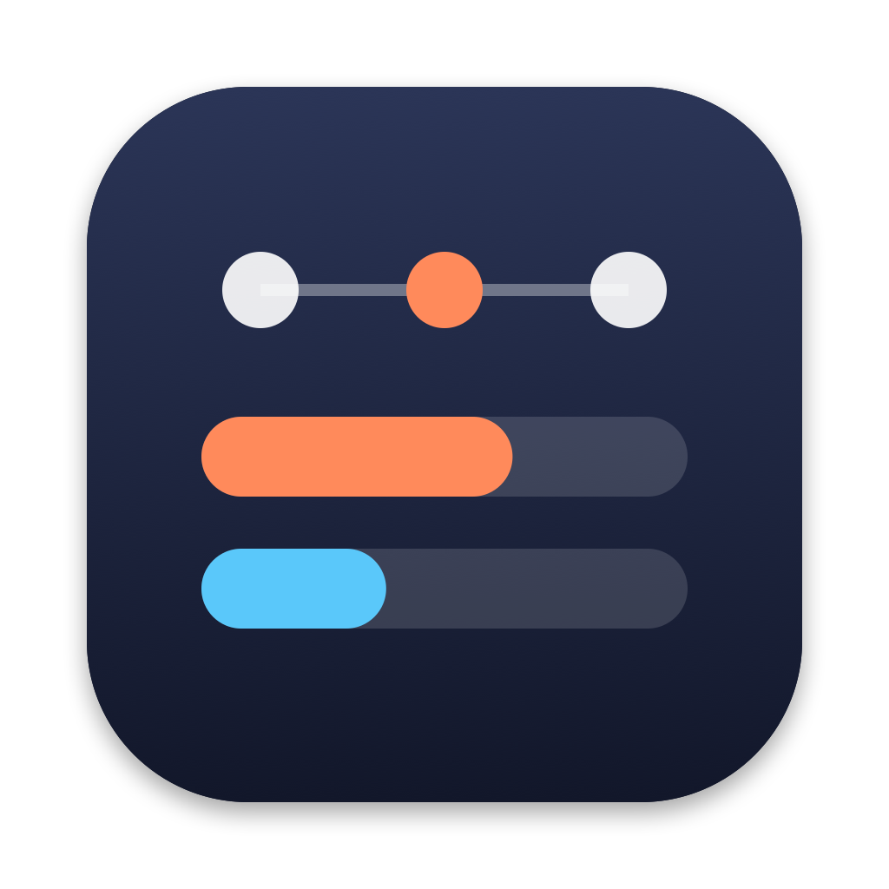

# AgentBar

[Read in English](README.md)

Um app para a barra de menus do macOS que mostra os seus limites de uso do Claude Code e os workflows dinâmicos rodando nas suas sessões.

> Projeto não oficial, sem relação com a Anthropic nem endosso dela. "Claude" e "Claude Code" são marcas da Anthropic.

## O que ele mostra

- **Na barra de menus:** o uso da sessão atual (5 horas) e da semana, um em cima do outro, como o item de CPU/MEM. O número fica laranja a partir de 70% e vermelho a partir de 90%.
- **Ao clicar:** os dois limites com barra de progresso e horário de reset, e os workflows rodando agora ou terminados nas últimas 24 horas.
- **Em cada workflow:** as fases e os agentes, com modelo, tokens e tempo, como no painel `/workflows` do Claude Code.

## Privacidade

O AgentBar só lê arquivos que o Claude Code grava no seu Mac, em `~/.claude`. Ele não faz nenhuma chamada de rede, não tem telemetria e nunca lê o seu token de login.

## Requisitos

- macOS 14 (Sonoma) ou mais novo, em Apple Silicon ou Intel.
- Claude Code. Os limites de uso aparecem quando o Claude Code os informa ao status line, o que depende do seu plano. Sem eles, o AgentBar continua mostrando os workflows.

## Instalação

### Download

1. Baixe o `AgentBar-<versão>.zip` em [Releases](https://github.com/WesleyNog/agentBar/releases) e descompacte.
2. Mova o `AgentBar.app` para a pasta Aplicativos.
3. Abra o app. O AgentBar ainda não é notarizado pela Apple, então o macOS bloqueia a primeira abertura. Para liberar, faça uma destas opções:
   - Abra **Ajustes do Sistema › Privacidade e Segurança**, role até o fim e clique em **Abrir Mesmo Assim** ao lado do aviso sobre o AgentBar. Depois confirme.
   - Ou rode no Terminal: `xattr -dr com.apple.quarantine /Applications/AgentBar.app`

   É preciso repetir isso a cada atualização.

### Compilar a partir do código

Precisa do Xcode 16 ou mais novo.

```bash
git clone https://github.com/WesleyNog/agentBar.git
cd agentBar
./scripts/bundle.sh
open build/AgentBar.app
```

Um app que você mesmo compila abre sem o aviso de segurança.

## Conectar ao Claude Code

Clique no item do AgentBar e depois em **Conectar…**. Antes de mudar qualquer coisa, o AgentBar mostra o que vai fazer:

- Instala um script pequeno em `~/.claude/agentbar/statusline.sh` e aponta o `statusLine` do `~/.claude/settings.json` para ele. Só essa entrada muda; o resto do arquivo fica exatamente como estava.
- Se você já usa um status line, ele continua funcionando: o script do AgentBar roda o seu comando anterior e imprime a saída dele.
- O `settings.json` ganha um backup em `~/.claude/agentbar/backups/` antes.

**Desconectar…**, nos Ajustes, devolve o status line que você tinha antes. Os Ajustes também têm **Abrir ao iniciar o Mac**.

Os limites atualizam sempre que uma sessão do Claude Code atualiza o status line, então só mudam enquanto você usa o Claude Code.

## Bom saber

- **"tok" é tamanho de contexto, não gasto.** Como no painel do próprio Claude Code, os tokens de um agente são o tamanho do contexto dele na última resposta, e o total do workflow é a soma dos agentes. O seu consumo de verdade é o que as porcentagens mostram.
- **Os workflows vêm de arquivos internos do Claude Code.** Uma atualização do Claude Code pode mudar o formato deles. Se algo parecer errado, `swift run agentbar-dump` mostra o que o AgentBar está lendo. A saída inclui os nomes dos seus projetos e workflows, então revise antes de colar numa issue.
- **Só este Mac.** Uso feito no claude.ai ou em outros computadores aparece na próxima vez que uma sessão do Claude Code neste Mac atualizar o status line.

## Desinstalar

1. Abra **Ajustes…** e clique em **Desconectar…** para voltar ao status line anterior.
2. Saia do AgentBar e mova o app para o Lixo.
3. Se quiser, apague `~/.claude/agentbar`.

## Desenvolvimento

```bash
swift build                 # compila em debug
swift test                  # testes
swift run agentbar-dump     # o que o AgentBar lê, no terminal (com --json para JSON)
./scripts/bundle.sh         # build/AgentBar.app
./scripts/release.sh        # build/AgentBar-<versão>.zip, universal (Apple Silicon e Intel)
```

- `Sources/AgentBarCore`: lê e interpreta os arquivos do Claude Code. Sem interface; coberto pelos testes.
- `Sources/AgentBar`: o app da barra de menus.
- `Sources/agentbar-dump`: a ferramenta de diagnóstico.

A spec e o plano estão em [SPEC.md](SPEC.md) e [PLAN.md](PLAN.md).

## Licença

[MIT](LICENSE) © 2026 Wesley Nogueira
